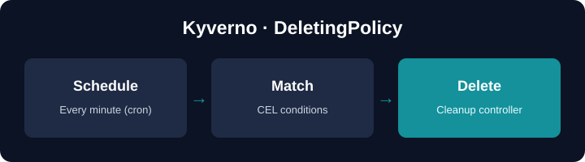

 

# DeletingPolicy — clean up resources on a schedule

A **DeletingPolicy** (API group `policies.kyverno.io/v1`) deletes existing
resources on a **cron schedule** when CEL conditions match — for example
temporary Pods, finished Jobs or expired ConfigMaps. It does not run at
admission time: Kyverno's **cleanup controller** wakes up on schedule, lists the
matching resources and deletes them.

In this hands-on deep dive you will:

| You'll learn | Concept |
|--------------|---------|
| Delete on a schedule | `spec.schedule` (cron) |
| Pick exactly what goes | `matchConstraints` + CEL `conditions` |
| Age-based cleanup | `time.now()` in CEL |
| What happens to children | `deletionPropagationPolicy` |
| The #1 gotcha | RBAC for the cleanup controller |
| Do it yourself | a final **challenge** you solve in the terminal |

## Replaces CleanupPolicy

The legacy `CleanupPolicy` / `ClusterCleanupPolicy` (`kyverno.io`) are
deprecated in v1.19 and will be removed in v1.20. `DeletingPolicy` is their
CEL-based successor.

## Setup

Kyverno **v1.19** is being installed in the background, the cleanup controller
is granted the extra RBAC these steps need, and a `demo` namespace is created.
Wait for the short progress indicator in the terminal to finish, then click
**START**.
