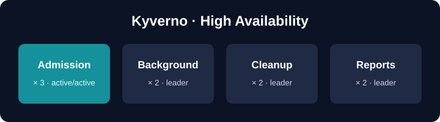

 

# Kyverno in High Availability

Kyverno checks **every** API request that matches one of its policies. By
default its webhooks **fail closed**: if Kyverno is down, the API server
rejects those requests. In production, Kyverno must keep working when a Pod
crashes, a node is drained or the cluster is upgraded. For that you run it in
**high availability** (HA).

A default install runs four Deployments with **one replica each**. In this
guided lab you will learn:

| You'll learn | Concept |
|--------------|---------|
| Install Kyverno in HA | `replicas` per controller, with Helm |
| Spread replicas across nodes | pod anti-affinity |
| Who does the work | active/active vs leader election (Leases) |
| Stay up during planned maintenance | PodDisruptionBudgets |
| Prove it | a failure test: delete the leader, the policy still works |

## Setup

This lab runs on **two nodes** (`controlplane` and `node01`). Kyverno is **not**
installed yet — you install it yourself in Step 1. The cluster is being
prepared in the background. Wait for the short progress indicator in the
terminal to finish, then click **START**.

> Only in this lab: the control-plane node also runs normal workloads, so there
> are two nodes to spread replicas across. In production, run Kyverno on
> dedicated worker nodes — ideally three or more, in different zones.
