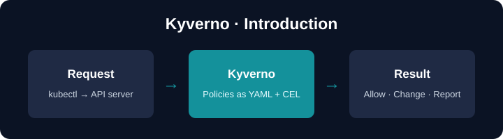

 

# Kyverno — an introduction

## What is policy management?

In Kubernetes, everything is configuration: Pods, Deployments, Namespaces,
and more. Developers, operators and platform teams all write and change this
configuration. With so many people and so many details, it is hard to keep it
safe and consistent by hand.

**Policies** are rules about that configuration. For example: "every Pod must
have a `team` label", or "every new Namespace gets a default NetworkPolicy".
Policy management means writing these rules once, and letting a tool apply
them for you.

## What is Kyverno?

**Kyverno** (Greek for "govern") is a policy engine for Kubernetes and other
cloud native systems. It is a CNCF project.

- You write policies in **YAML and CEL** — no new language to learn.
- Policies are normal **Kubernetes resources**: you manage them with
  `kubectl`, Git and your usual tools.
- Kyverno can **validate**, **mutate** (change), **generate** and **delete**
  resources, and it records the results in **reports**.

In this guided lab you will learn:

| You'll learn | Concept |
|--------------|---------|
| Install Kyverno | Helm chart |
| The parts of Kyverno | controllers, CRDs, certificates |
| How a request reaches Kyverno | admission webhooks |
| Where results go | events and PolicyReports |
| What comes next | a map of this course |

This lab has no policies yet — the next scenarios teach each policy type.

## Setup

Kyverno is **not** installed yet — you install it yourself in Step 1. The
cluster is being prepared in the background. Wait for the short progress
indicator in the terminal to finish, then click **START**.
