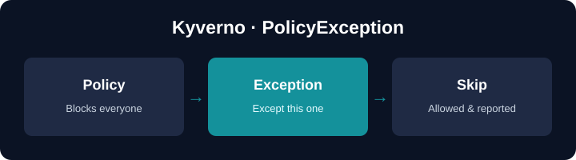

<br>

# PolicyException — exempt resources, safely

Policies should be broad; real life has exceptions — a legacy app, a debug Pod,
a vendor workload. A **PolicyException** (API group `policies.kyverno.io/v1`)
lets specific resources **skip** a specific CEL policy, without weakening the
policy for everyone else. The skip is recorded in PolicyReports, so it stays
visible.

In this hands-on deep dive you will:

| You'll learn | Concept |
|--------------|---------|
| Point an exception at a policy | `spec.policyRefs` |
| Exempt exactly what you mean | CEL `matchConditions` |
| Where skips show up | PolicyReports (`skip`) |
| Who may create exceptions | the allowed exceptions namespace |
| Time-boxed exceptions | `expiresAt` + `properties` |
| Do it yourself | a final **challenge** you solve in the terminal |

## Off by default

PolicyExceptions are **disabled** in a default Kyverno install. In this lab they
were enabled with two Helm values, and accepted **only** from the `exceptions`
namespace:

```
features.policyExceptions.enabled=true
features.policyExceptions.namespace=exceptions
```

## Setup

Kyverno **v1.19** is being installed in the background with PolicyExceptions
enabled, and the `exceptions` and `sandbox` namespaces are created. Wait for the
short progress indicator in the terminal to finish, then click **START**.
