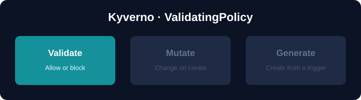

 

# ValidatingPolicy — allow or block resources

A **ValidatingPolicy** (API group `policies.kyverno.io/v1`) is the new,
CEL-based way to decide if Kubernetes accepts a resource. It replaces the
`validate` rules of the old `ClusterPolicy`.

This is a hands-on lab, not a quick tour. You will learn:

| You'll learn | Concept |
|--------------|---------|
| Block vs report vs warn | `validationActions`: `Deny` / `Audit` / `Warn` |
| What a policy matches | `matchConstraints.resourceRules` |
| Writing safe CEL | optional fields, checking a value in a list |
| Messages with live data | `messageExpression` |
| Where violations appear | PolicyReports |
| Do it yourself | a final **challenge** you solve in the terminal |

## Why CEL, not ClusterPolicy?

The old `ClusterPolicy` / `Policy` (`kyverno.io/v1`) are deprecated: they still
work, but v1.19 is the last release with full support. The CEL types are the
future, and they use the same expression language as the native Kubernetes
admission policies.

## Setup

Kyverno **v1.19** is being installed in the background, so the stable
`policies.kyverno.io/v1` CRDs are ready. Wait for the short progress indicator
in the terminal to finish, then click **START**.
